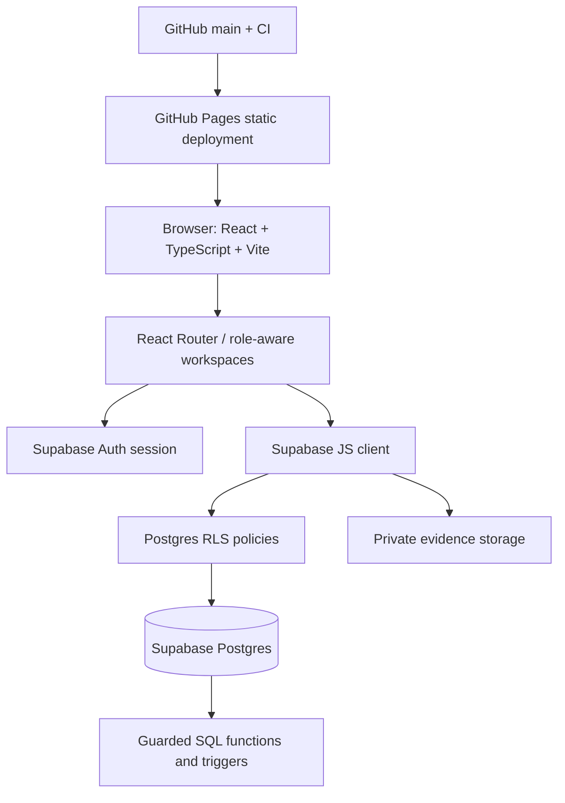

# Simorgh — Repository & Product Audit

**Audit date:** 2026-10-15  
**Scope:** Current `main` source, Supabase migration/project state, published GitHub Pages app, and CI configuration.  
**Purpose:** Keep implementation evidence-led and extend the existing product without replacing its stack.

## 1. Verified current architecture

- **Frontend:** React 19, TypeScript, Vite, React Router, custom CSS, Lucide icons, and Recharts.
- **Application entry:** `index.html` → `src/main.tsx` → `BrowserRouter` (base path from Vite) → `AuthProvider` → `src/App.tsx`.
- **Authentication:** Supabase Auth and session/membership state remain in `src/lib/AuthContext.tsx`, but the public login/sign-up/password-reset forms were intentionally removed from the root UI at the user's current request. `/auth` redirects to the root role portal. If a valid session already exists, the source retains the protected operational app routes; the public role cards do not create or grant a session.
- **Data access:** Browser-side `@supabase/supabase-js` in `src/lib/supabase.ts`. Database access depends on Postgres RLS and guarded SQL functions; hiding a UI element is not the authorization boundary.
- **Database:** Supabase Postgres project `aoxerjimfiwusidaparx`, region `eu-central-1`. Migration `supabase/migrations/20261015000000_simorgh_core.sql` is applied. All 18 application tables report RLS enabled. Initial company row `شبکه سیمرغ` exists, with no owner membership yet.
- **Hosting:** Static SPA on GitHub Pages at https://ehsanamn1.github.io/simorgh/; automatic deploy is gated on a successful `Simorgh CI` workflow. Optional Cloudflare Pages workflow remains in the repository.
- **Storage:** Private Supabase Storage bucket `delivery-evidence` and associated access policies exist in the migration; upload/access scenarios still need role-by-role verification.
- **Latest verified test baseline (2026-10-15):** [CI run 38757452211](https://github.com/Ehsanamn1/simorgh/actions/runs/38757452211) succeeded. Vitest: 4 passed. Playwright: 18 passed in desktop (1365×900), mobile (390×844), and compact mobile (360×800) Chromium. Production npm audit reported 0 vulnerabilities, and the /simorgh/ production build succeeded. Tests cover public-role UI and responsive behavior, not operational RLS boundaries.

## 2. Architecture diagram

## 3. Domain model currently represented

- `companies` is the tenant root; `memberships` binds authenticated users to a company and role.
- `customers`, `suppliers`, and `products` are company-scoped entities.
- `price_agreements` links customer, product, unit price, minimum quantity, and validity window.
- `orders` contains order headers; `order_items` links product and quantity to an order and can be allocated to a supplier, capacity commitment, and production lot.
- `capacity_commitments` records supplier/product capacity over a date range, including declared, confirmed, and committed quantities.
- `lots` and `quality_reviews` represent traceable batches and inspection outcomes.
- `shipments` link to orders; `delivery_evidence` records proof such as images, notes, signatures, and temperature readings.
- `invoices` and `settlements` store internal invoice and settlement states; they do not move or verify bank funds.
- `notifications` and `audit_events` hold in-app notifications and change history.

## 4. Feature matrix

| Area | Current state | Notes / acceptance gap |
|---|---|---|
| Sign-in, sign-up, password reset | **UI intentionally disabled** | Auth/session infrastructure remains, but the public UI cannot start a new session. If the forms are re-enabled later, validate redirects, email verification/recovery and actual Supabase behavior. |
| Organization isolation and memberships | **Implemented baseline** | First trusted owner must be assigned; test object-level access for every role. |
| Company command dashboard | **Implemented baseline** | Four metrics are queried from real records; chart describes recent orders, not a full historical BI warehouse. Avoid fake/forecast values. |
| Customers, suppliers, products, price agreements | **Implemented baseline** | Validate required business fields, pricing rules, and real commercial processes. |
| Orders and capacity allocation | **Implemented baseline** | SQL transition/allocating functions exist; concurrency and capacity boundaries require end-to-end tests. |
| Lots and quality reviews | **Partial** | Basic batch/review records exist; end-to-end source-to-customer traceability and corrective-action workflows are incomplete. |
| Shipments and delivery evidence | **Partial** | Shipment stages and private evidence exist; actual GPS collection, live map, carrier acceptance workflow, offline syncing, and discrepancy handling are not implemented. |
| Invoices and partner settlements | **Partial** | Internal status records exist; bank movements, collection allocation, approved expenses, advances, a contract-versioned 50/50 profit/loss engine, and statement reconciliation are missing. |
| Farm sites, flock cycles, production batches, daily tasks | **Missing** | Needed before the platform can replace daily farm production logs. |
| Inventory and procurement | **Missing** | No stock ledger, goods receipts, reservations, purchasing lifecycle, or versioned feed-use records in current schema. |
| Driver/transport contractors | **Partial** | Role-specific shipment list is a starting point; trip acceptance, GPS observations, stale-location state, rates, and contractor statements are absent. |
| AI agents and approvals | **Missing** | No agent orchestration, run log, tool allowlist, approvals inbox, scheduler, or AI governance layer found in current source. |
| Notifications/jobs | **Partial** | Notification table exists; delivery channels, idempotent job runner, retries, and visible failure monitoring are not configured. |
| External camera / telemetry integrations | **Not configured** | Never claim a camera, GPS tracker, or sensor is connected without a verified adapter and successful device-level test. |
| Public role-selection portal | **Implemented and browser-tested** | Four structural role previews; no auth forms on /; motion honors reduced-motion preference. Tests verify the public UI at 3 viewport sizes, but they do not constitute real-role authorization tests. |

## 5. UI/UX audit and direction

### Confirmed issues in the original source
- Most secondary text, form labels, table cells, sidebar links, and status labels used 7–10px fonts, including mobile overrides. This is too small for a dense operational product and made the UI feel like an admin template.
- Several page-section eyebrow labels were English internal identifiers while the actual workspace was Persian/RTL.
- The mobile breakpoint hid the full search input, leaving only a decorative search icon.
- The dashboard advertised a keyboard shortcut `⌘ K` without an implementation.
- Three “first actions” on the command dashboard were static `div` elements rather than links, despite appearing actionable.
- The initial dashboard uses live counts and current records; empty states explicitly avoid demo metrics. Preserve that data integrity.

### UI changes implemented
- Public `/` now opens directly into role selection rather than a login/sign-up screen. `/auth` redirects to `/` while forms are disabled.
- The four role cards have distinct audience labels and previews: manager/owner, supplier/farm partner, driver/transport contractor, and organizational customer.
- The manager preview explicitly surfaces user/role assignment and change history. Role selection itself does not assign access or expose private records.
- Refined typographic scale, spacing, accessible touch targets, tables/forms, Persian labels, mobile search, and real links replace the earlier tiny admin-template style.
- Motion design includes orbit rings, animated supply-chain nodes/flow indicators, soft reveals, focus/hover transitions, and reduced-motion support.
- Verified in CI run [38770634676](https://github.com/Ehsanamn1/simorgh/actions/runs/38770634676): 27 Playwright tests and 4 Vitest tests passed. Typecheck, lint, production audit (0 production vulnerabilities), and Pages base-path build also passed. The same runtime commit was deployed successfully in [run 38770881239](https://github.com/Ehsanamn1/simorgh/actions/runs/38770881239). These checks verify the public role-screening experience only; role isolation against actual Supabase accounts remains unverified.

### Reference research used for principles, not for copying
- [TraceFarm — platform screens](https://tracefarm.eu/screens): the product groups task/deadline and financial views alongside the farm dashboard.
- [FarmAct — field operations](https://givi.design/projects/farmact): a useful reference for treating mobile workers and the office control view as one workflow.
- [Supply Chain Dashboard UX case study](https://venkateshux.com/portfolio/ux-case-study-supply-chain-dashboard/): centralizing suppliers, purchase orders, catalogue and billing.
- [Exception-first operations dashboard concept](https://www.leeonex.com/case-studies/exception-first-operations-dashboard-concept): prioritizing actionable exceptions, freshness of data, ownership, and next action. The source labels itself a concept study, not a measured client deployment.

## 6. Security and operational risks

- RLS is enabled on each of the 18 application tables, but that alone does not prove every policy is correct. Run negative access tests using separate owner, staff, customer, supplier, and driver accounts.
- Supabase security advisors report warnings for authenticated access to guarded `SECURITY DEFINER` RPC functions, plus RLS query-planning and index recommendations. Review function bodies and verify that unauthorized callers cannot act; do not treat an advisor warning as either proof of exploitability or proof of safety.
- The first company exists, but at the last database check there were no registered users and no owner membership. Login/sign-up forms are intentionally disabled; a trusted owner must be created through a controlled Supabase Dashboard procedure and then granted membership before operational workspaces can be tested.
- Keep `service_role` / database secrets off the browser and out of `VITE_` variables. Only the publishable key belongs in the static build.
- No independent security audit has been conducted. Payment, tax invoice, SMS, Google OAuth, live GPS, live camera, and AI providers are not configured as working integrations.

## 7. Latest automated acceptance and remaining gates

### Passed for the public role-screening release
- The unauthenticated root renders the RTL role-selection page and does not show login, sign-up, or password-reset fields.
- Manager/owner, farm/supplier partner, driver/transport contractor and customer role cards render distinct structural previews.
- Preview navigation and capability labels work; role selection does not create authorization or query private rows.
- Desktop/mobile/compact-mobile Chromium checks passed with no horizontal page overflow and no uncaught page exceptions in the covered flows.
- Vitest 4/4, Playwright 18/18, TypeScript, ESLint, production audit, Pages build and deployment passed on the referenced workflow runs.

### Not accepted as operationally complete
- New authentication/onboarding is intentionally disabled. There is still no owner membership documented as provisioned; previews are not live operational role panels.
- No separate authenticated-account test has proven customer-to-customer, farm-to-farm or driver-to-unassigned-trip isolation. RLS being enabled does not by itself prove each policy is correct.
- Production/farm/task lifecycle, inventory/procurement, contract-versioned 50/50 settlement, fully assigned driver tracking, and AI job/approval integrations remain missing or partial as documented above.

See [ACCEPTANCE_CHECKLIST.md](ACCEPTANCE_CHECKLIST.md) for release gates mapped to the master implementation prompt.

## 8. Implementation order and regression risks

1. **Public role-selection portal + browser smoke checks** (completed for this release): polished public entry, four structural workspace previews, explicit role-assignment governance, motion and responsive rendering; keep auth UI disabled per request.
2. **Owner onboarding and role-level RLS tests (next operational gate):** prerequisite to safe use by real users.
3. **Farm/partner contracts and production lifecycle:** farm sites, contract versions/amendments, flock cycles, batches, approved daily tasks, evidence, and incidents. Use additive migrations.
4. **Inventory/procurement and operational expenses:** transaction-ledger basis before balances or forecasts.
5. **Contract-versioned 50/50 reconciliation:** deterministic calculations, separate incurred/approved/paid/allocated/settled amounts, reversals and audit trail; never implement as a display-only percentage.
6. **Logistics completion:** carrier/driver assignments, timestamps, evidence, discrepancies, GPS adapter and stale state—only after an actual device/browser capability test.
7. **AI agents last:** bounded read tools first, auditable draft recommendations, approvals for external/financial actions; never arbitrary SQL or autonomous veterinary treatment.

**Regression guardrails:** keep current route names and roles, never seed production workflows, retain current Supabase project and data, apply additive migrations, and require CI success before deploying.
